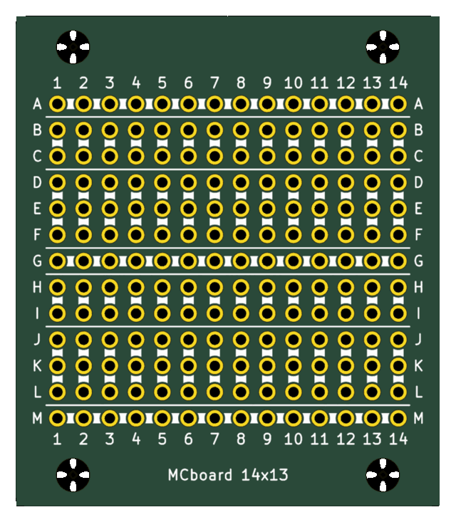
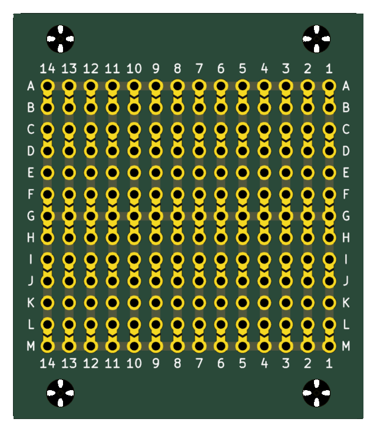
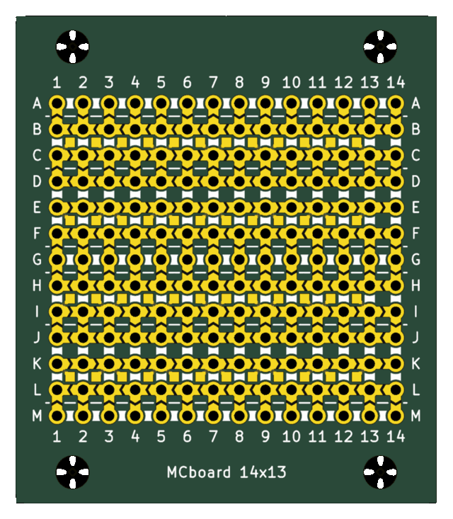

# MCboard

A parametric solderable protoboard. A Python script writes the KiCad project and the files a PCB fab needs, for any
number of rows and columns. A second script takes a board with the parts of a circuit placed on it, and says which
solder jumpers to close and which wires to add.

| Top | Bottom | Top with `--top smt` |
|---|---|---|
|  |  |  |

*A 14x13 board, rendered by KiCad.*

**Status.** The output passes KiCad's DRC against the fab rules, and the Gerbers match KiCad's own export. See
[Limits](#limits).

**[User manual](docs/MANUAL.md)**: generating a board, and planning a circuit on it, step by step.

## The pattern

Like a breadboard, but soldered, and every connection between groups is your choice. By default the pattern repeats
every 6 rows:

```text
       1   2   3   4
  A    o---o---o---o---   bus: one horizontal track across the board
       x   x   x   x      chevron solder jumper, open until you bridge it
  B    o   o   o   o      2-contact group
  C    o   o   o   o        a vertical strip per column
       x   x   x   x
  D    o   o   o   o      3-contact group
  E    o   o   o   o        a vertical strip per column
  F    o   o   o   o
       x   x   x   x
  G    o---o---o---o---   the next bus
```

Close a 2-3 chevron and the two groups become a strip of 5, as on a breadboard; close the others to reach a bus. All
tracks are on the bottom side, under solder mask. `--pattern` sets other arrangements, such as `b+5`, `b+3+2+2b+5` or
`classic`, a breadboard with two rails; `--top smt` adds chevrons and islands on the top side for SMD parts. See
[the manual](docs/MANUAL.md#15-row-pattern).

## Quick start

You need Python 3 and nothing else; KiCad is needed only to check the board or place a circuit on it.

```bash
cd protoboard_generator
python3 generate_protoboard.py --cols 30 --rows 61 --fab jlcpcb
```

This writes the KiCad project, a zip for the fab and an A4 PDF of both sides, like those in [`examples/`](examples/). Upload the zip and order a **2-layer
board, 1 oz copper**.

To plan a circuit, generate the board with `--working-copy`, which also writes `<name>_working.kicad_pcb`. In KiCad,
update that file from your schematic, place the parts with their pins on the holes, save, and run:

```bash
python3 plan_board.py <folder>/<name>_working.kicad_pcb
```

It prints which chevrons to close and which wires to add, and writes a PDF with both sides marked. The same is
available as a button in KiCad's PCB editor, installed with `python3 install_kicad_plugin.py`.

Everything else, options, mounting holes, checking a board, reading the plan and drawing part of the wiring yourself,
is in the [user manual](docs/MANUAL.md).

## Limits

- With `--top smt`, excess solder can close a chevron hidden under a part.
- The planner is a heuristic: it always gives the same plan for the same board, but that plan may not have the fewest
  wires or chevrons, and placement decides whether a plan exists at all.
- The KiCad button needs KiCad 9.0 or later with its API turned on, and fetches the `kicad-python` package the first
  time.
- Text in very dense characters, such as CJK at 1 mm, may fill in when printed.
- There is no automated test suite yet.

## Repository layout

| Path | Contents |
|---|---|
| `protoboard_generator/generate_protoboard.py` | The generator's entry point |
| `protoboard_generator/plan_board.py` | The planner's entry point |
| `protoboard_generator/install_kicad_plugin.py`, `kicad_plugin/` | The KiCad button |
| `protoboard_generator/protoboard/` | The code. Its `__init__.py` is the reading guide |
| `protoboard_generator/rules/`, `fonts/` | Fab rules and the stroke font, see `NOTICE.md` |
| `examples/` | Generated boards ready to open or order: a classic breadboard, the default, and the default with `--top smt` |
| `tests/t555/` | Test boards for the planner: a 555 circuit, imported and placed |
| `docs/MANUAL.md` | User manual: generating a board, then planning a circuit |
| `docs/DESIGN.md` | Design notes: why the pattern is what it is, every dimension, what was rejected, how to check changes |

## Licence

Copyright (C) 2026 [mcesar67](https://github.com/mcesar67).

The code and documentation were written with the help of Claude (Anthropic), under the author's direction.

GPL-3.0-or-later, see [`LICENSE`](LICENSE). Third-party material and its licences are listed in [`NOTICE.md`](NOTICE.md).
There is no warranty of any kind: check a board before you pay for it.
