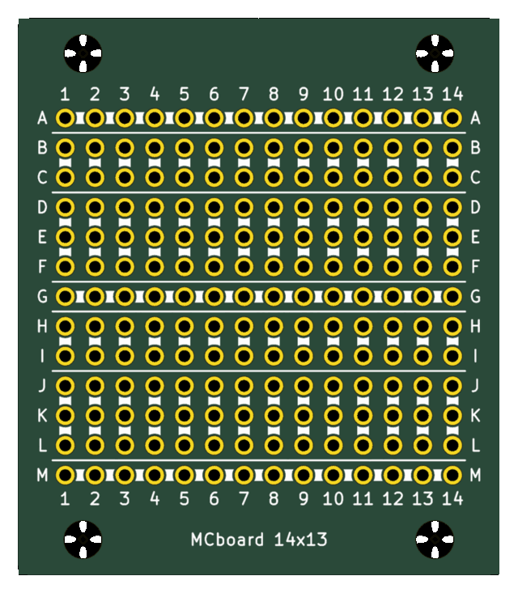
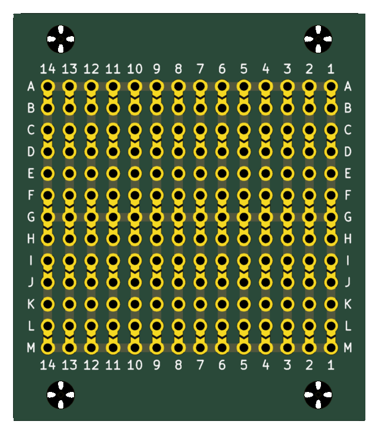
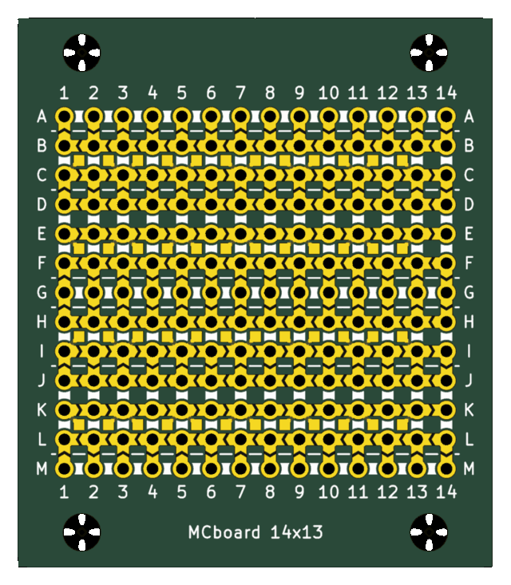

# MCboard user manual

MCboard is a solderable protoboard that you generate to measure. This manual has two parts, which you can use
apart:

- **[Part 1. Generate a board](#part-1-generate-a-board)**: choose the size and the pattern of rows, get the KiCad project
  and the files a PCB fab needs, check them and order the board. `generate_protoboard.py` does this.
- **[Part 2. Plan a circuit](#part-2-plan-a-circuit)**: place the parts of a circuit on a generated board in KiCad, and get
  the list of solder jumpers to close and wires to add, with a printable drawing. `plan_board.py`, or the **MCboard
  plan** button in KiCad, does this.

You only need Part 1 to make boards and wire them by hand. Part 2 needs a board from Part 1.

Contents:

- [The board](#the-board)
- [Part 1. Generate a board](#part-1-generate-a-board)
  - [1.1 Requirements](#11-requirements)
  - [1.2 First board](#12-first-board)
  - [1.3 Output files](#13-output-files)
  - [1.4 Size](#14-size)
  - [1.5 Row pattern](#15-row-pattern)
  - [1.6 Top side and SMT parts](#16-top-side-and-smt-parts)
  - [1.7 Silkscreen, name and text](#17-silkscreen-name-and-text)
  - [1.8 Mounting holes](#18-mounting-holes)
  - [1.9 Fab rules and dimensions](#19-fab-rules-and-dimensions)
  - [1.10 Check the board](#110-check-the-board)
  - [1.11 Order the board](#111-order-the-board)
  - [1.12 Fit modules and headers](#112-fit-modules-and-headers)
  - [1.13 Generator options](#113-generator-options)
- [Part 2. Plan a circuit](#part-2-plan-a-circuit)
  - [2.1 What the plan gives you](#21-what-the-plan-gives-you)
  - [2.2 Requirements and installing the button](#22-requirements-and-installing-the-button)
  - [2.3 Prepare the board](#23-prepare-the-board)
  - [2.4 Place the parts](#24-place-the-parts)
  - [2.5 Run the plan](#25-run-the-plan)
  - [2.6 Read the report](#26-read-the-report)
  - [2.7 Read the drawing](#27-read-the-drawing)
  - [2.8 Decide part of the wiring yourself](#28-decide-part-of-the-wiring-yourself)
  - [2.9 Change the board under a circuit](#29-change-the-board-under-a-circuit)
  - [2.10 Messages](#210-messages)
  - [2.11 Limits](#211-limits)
  - [2.12 Troubleshooting](#212-troubleshooting)

## The board

These words are used in both parts.

| Word | Meaning |
|---|---|
| **Hole** | A plated hole of the grid, 2.54 mm apart, with a pad on both sides. Named by row letter and column number: `C4` is row C, column 4. |
| **Group** | A number of rows whose holes are joined down each column by a track on the bottom side. |
| **Strip** | What one group joins in one column: the holes that are always one net. |
| **Bus** | A whole row joined by a horizontal track: a rail across the board. |
| **Space** | A row of the grid with nothing on it, which nothing crosses. |
| **Chevron** | A solder jumper between two neighbouring holes of different strips or of a strip and a bus. It is open until you bridge it with solder. |
| **Island** | With `--top smt`, a small square pad between four holes, tied for good to one of them, for the feet of SMD parts. |

The default board repeats every 6 rows:

```text
       1   2   3   4
  A    o---o---o---o---   bus: one horizontal track across the board
       x   x   x   x      chevron solder jumper, open until you bridge it
  B    o   o   o   o      2-contact group
  C    o   o   o   o        a vertical strip per column
       x   x   x   x
  D    o   o   o   o      3-contact group
  E    o   o   o   o        a vertical strip per column
  F    o   o   o   o
       x   x   x   x
  G    o---o---o---o---   the next bus
```

Close a chevron between the 2 and 3 groups and they become a strip of 5, as on a breadboard. Close the others to
reach a bus. All tracks are on the bottom side, under solder mask: only the pads and the chevrons are exposed.

| Top | Bottom |
|---|---|
|  |  |

*A 14x13 board with the default pattern, rendered by KiCad. The bottom is seen from below, so its text reads normally.*

Columns are numbered and rows lettered on both sides of the board, and the text on the bottom reads correctly from
that side. After `Z` come `AA`, `AB` and so on.

---

# Part 1. Generate a board

## 1.1 Requirements

- Python 3. The generator uses only the standard library.
- KiCad 9 is not needed to generate a board, only to look at it, check it or edit it.

Run the commands from the `protoboard_generator` folder. On Windows, use `python` or `py` instead of `python3` if that
is the command you have.

## 1.2 First board

```bash
cd protoboard_generator
python3 generate_protoboard.py --cols 30 --rows 61 --fab jlcpcb
```

This writes a 30 x 61 board with the default pattern and JLCPCB's design rules, in a new folder named
`30x61_YYYYMMDDTHHMM/` (the date and time) under the current folder. The console lists the files, the mounting holes
and where the name went, and ends with a summary such as:

```text
.../MCboard_30x61.kicad_pcb: 30x61 holes (1830), ... chevrons, ... nets, board ... x ... mm
```

To choose the folder and the name, use `-o`:

```bash
python3 generate_protoboard.py --cols 14 --rows 13 -o my_board/board      # my_board/board.kicad_pcb and the rest
python3 generate_protoboard.py --cols 14 --rows 13 -o my_board/           # my_board/MCboard_14x13.*
```

A value ending in a slash, or naming a folder that already exists, is a folder for the default name.

**Generating over an existing output overwrites it, and anything you edited in KiCad is lost.** With the default
folder that can only happen within the same minute.

## 1.3 Output files

For `-o folder/name`:

| File | Contents |
|---|---|
| `name.kicad_pcb`, `.kicad_pro`, `.kicad_dru` | The KiCad project, in KiCad 9 format, with the fab's design rules. |
| `name_<w>x<h>_mm.zip` | What the fab needs: Gerbers, job file and drill files. `<w>x<h>` is the board size in whole mm, rounded up. |
| `name.pdf` | A printable A4 drawing of both sides, with the command that made it at the foot of the page. |
| `name_working.kicad_pcb` and its project | Only with `--working-copy`: the board prepared for placing parts, see [Part 2](#23-prepare-the-board). |

The zip and the PDF are written by the generator itself, from the same geometry as the `.kicad_pcb`. They do not
contain anything you add later in KiCad.

**The PDF.** The top side and the bottom side, the bottom seen from below, so its text reads normally and column 1 is
on the right. The scale is the largest of 200 %, 141 % and 100 % at which they fit, and is written under the board;
print at actual size. A board too large for one A4 page at 100 % gets a page per side, and one whose single side does
not fit at 100 % gets no PDF, with a warning. The distances between mounting holes are written above the board. If
the PDF is open in a viewer that will not let it be replaced, as many do on Windows, it is written as `name-2.pdf`, up
to `-9`, with a warning.

## 1.4 Size

`--cols` and `--rows` give the size of the grid. Both are required. The board is the grid plus a margin on each side,
which holds the labels, the name and the mounting holes.

With the default pattern, use **`rows = 6k + 1`** (7, 13, 19, 25, ...) so that the board starts and ends on a bus.
With any other number the last group is cut short, and the generator warns and names the nearest numbers that work:

```text
Warning: with 15 rows the board does not end with a whole bus; the last group or bus is cut short. Try 13 or 19.
```

With another pattern the right numbers are different, and the warning gives them in the same way. `--rows` counts
every row of the grid, spaces included.

## 1.5 Row pattern

`--pattern` lists the rows from the top, as elements joined by `+`, and repeats them down the board. The default is
`b+2+3`.

| Element | Meaning |
|---|---|
| `2`, `3`, `5`... | A group of that many rows: one strip per column. |
| `b`, `2b`... | Bus rows. Each is a rail of its own net. |
| `s`, `2s`... | Spaces: rows with no holes, no chevrons, no tracks and no silkscreen. |
| `classic` | The whole pattern `2b+2s+5+2s+5+2s`. It cannot be combined with other elements. |

Upper and lower case are the same, and spaces around `+` are ignored. `+` needs no quotes in any shell.

Chevrons go between any two neighbouring strips: a group and the next, or a group and a bus. There is none between two
bus rows, which are separate rails (a closed jumper there would short two supplies), and none across a space.

Examples:

| Pattern | Board |
|---|---|
| `b+2+3` | The default: a bus, a group of 2, a group of 3. |
| `b+3+2` | The same with the group of 3 first. |
| `b+5` | Strips of 5 between buses. |
| `b+2+3+b+3+2` | Alternating, so the buses have the groups of 3 on both sides, then the groups of 2. |
| `2b+3+2` | Two rails, one per supply, say. Only the outer rails have chevrons, to the groups beside them. |
| `b+3+2+2b+5` | One bus and two groups, then two rails and a group of 5. |
| `5` | No bus at all: a board of strips. |
| `classic` | A classic breadboard: two rails, then two strips of 5 three pitches (7.62 mm) apart, which a DIP straddles. It has no chevrons: the rails reach the strips through wires only. |

A `classic` board that starts and ends on rails has `--rows 20`:

```text
  A    o---o---o---o---   rail
  B    o---o---o---o---   rail
       (2 spaces)
  C    o   o   o   o      strip of 5, rows C to G
  ...
  G    o   o   o   o
       (2 spaces)         a DIP-8 straddles here: pins on G and H
  H    o   o   o   o      strip of 5, rows H to L
  ...
  L    o   o   o   o
       (2 spaces)
  M    o---o---o---o---   rail
  N    o---o---o---o---   rail
```

**Rows are counted in two ways.** `--rows`, the name on the board and the summary count every row of the grid,
spaces included, because the size of the board follows from them. Row letters and net names count only the rows with
holes, as on a breadboard: on the board above, row C is the third row of holes although it is the fifth row of the
grid. When the two differ, the summary gives both, such as `10x14 holes (140) on a 10x20 grid`.

**Nets.** Each strip and each bus has a net of its own, so that KiCad's DRC checks the clearances between them:
`BUS_R<n>` for a bus on hole row `n`, and `C<col>_R<n>` for the strip of column `col` whose first hole row is `n`, both
counted from 1. `C4_R2` is the strip of column 4 that starts on row B.

## 1.6 Top side and SMT parts

`--top plain`, the default, has only the rings of the holes on the top side.

`--top smt` makes room for SMD parts on the top side:

- **Exposed chevrons**, the same size as those on the bottom: horizontal ones between columns on every row except the
  buses, and vertical ones between groups, over those on the bottom. There are none inside a group, where the holes are
  already joined, nor along a bus.
- **Islands**: a small square pad in the cell between four holes, tied for good to one hole's pad by a track under the
  mask, so that a SOT-23 can reach three separate strips. There is one row of cells per group of 2 rows or more, at the
  group's edge that has a vertical chevron. On the default pattern they are the cells B-C and E-F of each period.



*The top side of the same 14x13 board with `--top smt`.*

To fit a SOT-23 on the default pattern, centre it on an even-numbered column, with two feet on the islands at its sides
and the third on half of a vertical chevron. The centre of the part, measured down from row A of the same period:

| Island cell | Third pin | Offset from row A |
|---|---|---|
| B-C | up | 2.84 mm |
| B-C | down | 4.79 mm |
| E-F | down, towards the bus | 12.41 mm |

E-F with the third pin up leaves little copper under that foot; avoid it. One SOT-23 fits per two columns on each island
row. The fits are worked out from typical package sizes: check them against your part's datasheet.

With `--top smt`, excess solder can close a chevron hidden under a part. A chevron closed under a part is also
hidden once the part is soldered, so close and check them before fitting it.

`--top smt` cannot be used with `--silk outline`.

## 1.7 Silkscreen, name and text

`--silk` sets how the top silkscreen shows which holes are joined:

| Value | Drawing |
|---|---|
| `bars` | The default. A bar over each track, and a thin line between groups. With `--top smt` the lines break at the vertical chevrons. |
| `lines` | Short lines between joined holes. |
| `outline` | A capsule around each group and bus. Not with `--top smt`. |
| `none` | Nothing. The labels and the name stay. |

The column numbers and row letters go on both sides. `--label-size` sets their height (1.0 mm, the fabs' minimum) and
`--no-labels` leaves them out. Labels that do not fit in the margin are an error.

**Name.** `MCboard <cols>x<rows>` goes on the top silkscreen, in the first margin where it fits: bottom, top, right, left.
If it fits nowhere, which happens on very small boards and with `--no-mount-holes`, the generator warns and leaves it out.
`--margin 4.3` with `--no-mount-holes` makes room for it.

**Your own text.** `--text "..."` adds a line of text, placed like the name, in another margin if possible. A text
that fits nowhere is an error. The allowed characters are those of KiCad's stroke font: Latin, Greek, Cyrillic and CJK
ideographs and kana, among others, but no Hangul and no combining marks. `~{`, `_{`, `^{` and `${` are refused,
because KiCad reads them as formatting. Very dense characters, such as CJK at 1 mm, may fill in when printed.

## 1.8 Mounting holes

By default, M3 holes (3.2 mm, unplated) run along the outer margin, 3.0 mm from the edge, at a multiple of 5 mm apart,
and of 10 mm when that costs at most one extra hole. The holes on the two longer sides reach the corners; those on the
shorter sides fill the space between them, and may be none.

| Option | Effect |
|---|---|
| `--mount-spacing 40` | The largest automatic spacing, in mm, a multiple of 5. |
| `--mount-drill 3.2` | The hole diameter. |
| `--no-mount-holes` | No mounting holes, and a narrower margin all round. |

Each side can be set by hand with `--mount-top`, `--mount-bottom`, `--mount-left` and `--mount-right`, or `--mount-x`
(top and bottom) and `--mount-y` (left and right). A single side wins over its pair, and a side not given stays
automatic. The value is `holes x spacing : alignment`, with every part optional:

| Value | Meaning | Board grows? |
|---|---|---|
| `0` | No holes, and a narrower margin on that side | No |
| `3` | 3 holes, at the widest multiple of 5 mm that fits | No |
| `x40` | As many as fit at 40 mm | No |
| `3x40` | Exactly that | Yes, if needed |
| `:left` | The automatic holes, anchored at that end | No |

The alignment is `centre`, `left` or `right` on the top and bottom, and `centre`, `top` or `bottom` on the sides. It
can follow any value except `0`, as in `3x40:left`. Spacings are at least 5 mm.

When `3x40` has made the board larger than the grid needs, `--array-x centre|left|right` and `--array-y
centre|top|bottom` say where the grid goes in it. Where two sides meet, holes in the same place are one; holes too
close together are resolved in favour of the side given by hand, and the console says how many were left out.

Examples: four holes on an 88 x 64 mm rectangle, then two holes along the top only:

```bash
python3 generate_protoboard.py --cols 25 --rows 13 --mount-x 2x88 --mount-y 2x64
python3 generate_protoboard.py --cols 25 --rows 13 --mount-top 2x64 --mount-bottom 0 --mount-y 0
```

The console and the PDF give the distances between the holes. The holes connect to nothing; they show on the mask
layers and in the NPTH drill file, not on copper.

## 1.9 Fab rules and dimensions

`--fab` chooses the design rules written to the `.kicad_dru`, which KiCad's DRC checks:

| Value | Rules |
|---|---|
| `generic` | The default. Satisfies both JLCPCB and PCBWay. |
| `jlcpcb`, `pcbway` | That fab's 2-layer, 1 oz rules. |
| `none` | No fab rules. |

The rules come from [kicad-druid](https://github.com/Cimos/kicad-druid) and may differ from the fab's current page. The
fab has the last word: check its capabilities before ordering.

The default dimensions, in mm, fit those rules:

| Item | Default | Option |
|---|---|---|
| Pitch | 2.54 | `--pitch` |
| Drill | 1.0, which takes square header pins and common leads | `--drill` |
| Pad | 1.6 | `--pad` |
| Strip track / bus width | 1.0 / 1.0 | `--track`, `--bus` |
| Chevron gap / width / V depth | 0.25 / 1.0 / 0.3 | `--gap`, `--chev-width`, `--chev-depth` |
| Solder mask expansion | 0.05 | `--mask-margin` |
| Silkscreen line | 0.15 | `--silk-width` |
| Margin on sides with / without mounting holes | 8.5 / 4.0 | `--margin`, `--margin-plain` |

The generator refuses values that would break the board, such as a bus wider than the pads or a chevron gap below
0.15. Change the others only if you know why, and run DRC afterwards.

## 1.10 Check the board

Open the `.kicad_pcb` in KiCad and run **Inspect > Design Rules Checker**, or use KiCad's command line:

```bash
python3 generate_protoboard.py --cols 8 --rows 13 -o check/proto
kicad-cli pcb drc --severity-all -o check/drc.rpt check/proto.kicad_pcb
```

A clean result has 0 violations and 0 unconnected pads. To confirm that the fab rules are really loaded, generate a board
that must fail; it gives annular width violations on its 28 pads:

```bash
python3 generate_protoboard.py --cols 4 --rows 7 --pad 1.3 --chev-width 0.6 --chev-depth 0.2 -o check/bad
kicad-cli pcb drc --severity-all -o check/bad.rpt check/bad.kicad_pcb
```

You can also load the zip into your fab's Gerber viewer before ordering.

## 1.11 Order the board

1. Upload the zip.
2. Order a **2-layer board, 1 oz copper**. Two layers even with `--top plain`, because plated holes need a ring on both
   sides.

To order a board you have edited in KiCad, export the Gerbers and drill files from KiCad instead: the generator's zip
does not contain your changes.

**Never order from a board with parts placed on it** (Part 2): it is a working file.

## 1.12 Fit modules and headers

The rows named here are those of the default pattern.

- **Never put a row of pins on a bus row** (A, G, M, ...): all those pins would be shorted together.
- **Dual-row 2.54 mm headers (2xN)** fit on rows C and D of each period, across the 2-3 chevrons. Leave those chevrons
  open and each pin has its own net.
- **Chips that straddle a bus** give every pin a way out: a DIP-8 on rows F and I, for example.
- **A wide module**, such as one with pin rows 22.86 mm apart, fits with its pin rows on E and N, or F and O. The buses then
  fall only under the module.

To choose a pattern for a part, count how many free holes each pin keeps: a strip of `n` holes with a pin on it leaves
`n - 1` free, and closing chevrons makes longer strips.

## 1.13 Generator options

`python3 generate_protoboard.py --help` lists them all with their defaults.

| Option | Meaning |
|---|---|
| `--cols`, `--rows` | Size of the grid. Required. |
| `-o`, `--out` | Output `.kicad_pcb`, or a folder for the default name. |
| `--pattern` | Row pattern, see [1.5](#15-row-pattern). |
| `--top plain\|smt` | Top side, see [1.6](#16-top-side-and-smt-parts). |
| `--silk bars\|lines\|outline\|none` | Top silkscreen, see [1.7](#17-silkscreen-name-and-text). |
| `--label-size`, `--no-labels`, `--silk-width` | Labels and silkscreen lines. |
| `--text` | Your own text on the top silkscreen. |
| `--mount-*`, `--array-x`, `--array-y`, `--mount-spacing`, `--mount-drill`, `--no-mount-holes` | Mounting holes, see [1.8](#18-mounting-holes). |
| `--fab` | Design rules, see [1.9](#19-fab-rules-and-dimensions). |
| `--pitch`, `--drill`, `--pad`, `--track`, `--bus`, `--gap`, `--chev-width`, `--chev-depth`, `--mask-margin`, `--margin`, `--margin-plain` | Dimensions. |
| `--origin-x`, `--origin-y` | Where the board's corner sits on KiCad's drawing sheet (50, 50). |
| `--working-copy` | Also write the working copy for planning, see [2.3](#23-prepare-the-board). |

---

# Part 2. Plan a circuit

## 2.1 What the plan gives you

You place the parts of a circuit on a generated board in KiCad. The planner reads which pin is on which hole and which
net each pin belongs to, and works out:

- which **chevrons to close**, to join the strips of each net;
- which **wires to add** on the top side, where chevrons cannot reach;
- what to **check**: pins off centre, nets that share a strip, strips with no way out.

It gives a report and a PDF with both sides of the board marked. It never changes the copper, nets or footprints of
the board.

There are two ways to run it, with the same result:

- the **MCboard plan** button in KiCad's PCB editor, which also draws the marks on the board;
- `plan_board.py`, from the command line, on the saved file. KiCad is not needed for this.

The planner works only on boards made by `generate_protoboard.py`.

## 2.2 Requirements and installing the button

- KiCad 9.0, with its PCB editor and its Python scripting.
- Python 3, to run the installer or `plan_board.py`. Nothing beyond the standard library.

To install the button, from the `protoboard_generator` folder:

```bash
python3 install_kicad_plugin.py
```

It copies the plugin to a folder named `mcboard_plan` in KiCad's plugin folder:

| System | Default plugin folder |
|---|---|
| Linux | `~/.local/share/kicad/9.0/scripting/plugins` |
| Windows, macOS | `~/Documents/KiCad/9.0/scripting/plugins` |

If yours is elsewhere, for example when Windows keeps Documents in OneDrive, find it in the PCB editor with **Tools >
External Plugins > Open Plugin Directory** and give it:

```bash
python3 install_kicad_plugin.py --dir "C:\path\to\scripting\plugins"
```

`--version` changes the `9.0` in the default paths.

Then, in the PCB editor, choose **Tools > External Plugins > Refresh Plugins**. The button appears in **Tools > External
Plugins** and on the toolbar as **MCboard plan**.

**Update:** the plugin holds its own copy of the code, so run the installer again after updating MCboard. It replaces
only its own folder. Refresh the plugins, and restart KiCad if it still behaves as before.

**Uninstall:** delete the `mcboard_plan` folder and restart KiCad.

## 2.3 Prepare the board

1. Generate the board with `--working-copy`:

   ```bash
   python3 generate_protoboard.py --cols 14 --rows 13 --fab jlcpcb --working-copy -o my_circuit/board
   ```

   Order the board from `board_<w>x<h>_mm.zip`, and place the parts on `board_working.kicad_pcb`. The working copy is the
   same board, with a few layers set up for planning:

   | Layer | Contents |
   |---|---|
   | `User.1`, `MCboard.Connections` | A thin dotted line through the holes of each strip and bus, in place of the board's bars or outlines, which would cover your parts. |
   | `User.2` | The board's labels, name and text. |
   | `User.3`, `MCboard.ManualWires` | Wires you decide yourself, see [2.8](#28-decide-part-of-the-wiring-yourself). |
   | `User.4`, `MCboard.ManualChevrons` | Chevrons you decide yourself. |
   | `User.5`, `MCboard.Plan` | The button's marks. Draw nothing of your own here. |

   KiCad's grid origin is set on hole A1. A plain generated board works too, without those layers.

   **Generating again overwrites the working copy, parts included.** Generate once, then work on that file.

2. Draw the schematic in KiCad, with footprints assigned.
3. Open the working copy in the PCB editor and run **Tools > Update PCB from Schematic**, with **Delete footprints with no
   symbols turned off**. Otherwise KiCad deletes the board itself, whose footprints have no symbol.

To work in your own project's PCB instead of the working copy, see [2.9](#29-change-the-board-under-a-circuit).

## 2.4 Place the parts

Turn off `User.1`, and keep `User.2` on for the row and column labels. Set a grid of 50 mil (or 5, 10 or 25 mil) and
move each part so that its pins sit on the holes; with the grid origin on A1 they fall exactly on the hole centres.

**Placement decides whether a plan exists at all.** The rules, for the default pattern:

- **Never put a row of pins on a bus row** (A, G, M, ...). All those pins would be shorted together.
- **Straddle a bus with chips.** A DIP-8 with its pins on rows F and I gives every pin a way out. On rows B and E, all
  the strips on one side end up under the chip and all need the same bus, which only one net can use.
- **Keep two nets out of the same strip.** Each column has a strip of 2 holes (rows B-C, H-I, ...) and a strip of 3
  (rows D-F, J-L, ...), and all the holes of a strip are joined. Other patterns have other strips; the planner reads
  them from the board, so it needs no option.
- **Leave free holes.** Wires go on the top side, so they cannot end or run under a part or over a pin. A chevron through
  a bus gives the whole bus to one net.

A pin counts as in a hole when it is within 0.25 mm of its centre; beyond 0.05 mm you get a warning. An SMD pad on an
island takes the strip of that island; any other SMD pad is taken to connect to the nearest hole within 1.5 mm. A part
with no pin on the grid is listed as not on the board, and left out of the plan.

## 2.5 Run the plan

**With the button.** Press **MCboard plan**. It works on what the editor has now, so you need not save first. You get:

- a window with the report, which can stay open while you work. Pressing the button again updates it;
- `<board>_plan.pdf` next to the board, or in the temporary folder if the board has never been saved;
- marks on the `MCboard.Plan` layer (`User.5`): a ring on each chevron to close and the path of each wire. They form a
  group named `MCboard plan`, so you can select and delete them together. Each run replaces those of the last one.

If the board has no `MCboard.Plan` layer, the button adds it; KiCad lists it in the Layers panel only after the board is
saved and opened again. If `User.5` is already used under another name, the button refuses the board rather than delete
what is there: rename the layer or move its contents. The button never changes the layer's visibility; the report says
when the layer is hidden.

Move parts and press the button again as often as you like.

**From the command line.** Save the board, then:

```bash
python3 plan_board.py my_circuit/board_working.kicad_pcb
```

It prints the report and writes `board_working_plan.pdf` next to the board. `-o` sets another path for the PDF, and
`--no-pdf` prints only the report. The exit status is 0 for a complete plan, 1 for a plan with problems and 2 for a file
it cannot use.

## 2.6 Read the report

```text
Board: 14 x 13 holes. Parts on it: 6. Nets to join: 5.

Close 15 chevrons:
  DIS:
    C4-D4  bottom  (PBJP20)
  GND:
    I3-J3  bottom  (PBJP17)
  ...

Add 3 wires:
  W1  DIS:  D4 to D8   10.2 mm
  W2  GND:  F1 to I3   12.7 mm
  W3  VCC:  F7 to I6   10.2 mm
```

- **PROBLEMS**, at the top when there are any: what the plan could not do, such as two nets on one strip, a net that
  cannot reach a strip, or parts not on the board. See [2.10](#210-messages).
- **Close**: the chevrons to bridge with solder, per net. `C4-D4` is the chevron between those two holes, `bottom` or
  `top` is the side it is on, and `PBJP20` is its reference, to find it in KiCad.
- **Add**: the wires, per net, from hole to hole, with their length. `W1` is the wire's name in the drawing. A wire with more than one
  corner lists them, and so does a manual wire with any.
- **Check**: things to look at, which do not stop the plan.

Chevrons and wires you decided yourself are tagged `manual`.

## 2.7 Read the drawing

Print the PDF at actual size. It shows the top side, then the bottom side as you see it when you turn the board over,
so column 1 is on the right there. The report follows on the next pages. A board too large for A4 gets the report only.

| Mark | Meaning |
|---|---|
| Red | Chevrons to close |
| Blue | Wires to add, on the top side |
| Green | Parts, on the top side only |
| Black dots | Holes with a pin |

Every corner of a wire is drawn rounded and each end has a circle: a circle is a solder joint and a curve is not.

Close the chevrons that will be under a part before fitting it: once the part is soldered they are hidden.

## 2.8 Decide part of the wiring yourself

Draw what you want to decide, and the plan takes it as given and completes the rest. Use **Place > Draw Lines** with a
grid of 50 mil, from hole centre to hole centre. The working copy has two layers for this, `User.3` for wires and
`User.4` for chevrons; on any other board, enable both in **Board Setup > Board Layers**. If they show in the same
colour, change one in the **Appearance** panel. The working copy draws lines 0.3 mm wide so that they stand out; elsewhere,
set **Board Setup > Text & Graphics Defaults > Other Layers**. The width does not matter to the plan.

- **On `User.4`, a straight line between two holes with a chevron between them closes that chevron**: the bottom one, on a
  board that also has one on top. Any other line there is an error.
- **On `User.3`, every line is a wire**, even one across a chevron, and it may be diagonal. Its two ends connect, and they
  must be on holes.
- **Lines that meet sharply on a hole are separate wires, each soldered to that pad.** So two or more wires can go to one
  pad. A wire of the plan never ends on a pad where another wire ends.
- **A rounded corner connects to nothing.** To make one wire pass over a pad, round the corner: select both lines, then
  right-click > **Shape Modification > Fillet Lines**, or use **Place > Draw Arc**. A radius of 1 mm is plenty.
- **A sharp corner between holes is also a corner of the wire**, since it cannot be taken for a connection.

The report lists them like the others, tagged `manual`:

```text
    C4-D4  bottom  (PBJP20)  manual
  W1  DIS:  D4 to C7    9.3 mm  corners near D5, near C5  manual
```

The plan does not move or remove them, and does not check that a wire of yours can be fitted. It tells you under
**Check** when one runs under a part or ends on a hole with a pin, which may be what you want. Lines that join two nets
are an error and are all left out. Lines on strips with no net keep the plan off those strips. Delete a line and run the
plan again to undo it.

## 2.9 Change the board under a circuit

Everything the generator draws is in one locked group named `MCboard`. That lets you work on your own project's PCB, and
swap the board under a circuit, for instance to plan on a large board and then move to one generated to measure.

1. Open the project's PCB and use **File > Append Board** to add a working copy. Place it with hole A1 where you want
   it. The project keeps its own grid origin, so set it on A1: **Place > Grid Origin**, then click the centre of that hole.
2. Place the parts, draw your own lines and plan as above.
3. To change the board, for another size or pattern, click any hole to select the group and press **Delete**. Say yes
   if KiCad asks about locked items. The parts and your lines on `User.3` and `User.4` stay.
4. Append the new working copy and put its hole A1 exactly where the old one was. A1 is not in the same place on every
   board: it moves with the size and the mounting holes. The pads hide the origin's cross, so go by the coordinates:
   - In **Preferences > PCB Editor > Origins & Axes**, set **Display origin** to **Grid origin**. The status bar then
     reads X 0, Y 0 on the old A1.
   - Set a grid of 50 mil. If the group will not move, right-click **Unlock**.
   - Put the cursor on the centre of the new A1 and press **M**, so that the board moves by that hole, or use right-click
     **Move with Reference** and click A1.
   - Click when the status bar reads X 0, Y 0, and lock the group again.

   To see the cross as well, turn off **Pads** in **Appearance > Objects** while you move.
5. Run the plan again. Parts that no longer fit show in the report.

**Update PCB from Schematic** leaves the board alone as long as **Delete footprints with no symbols** stays off.

Order the board from the zip of the board you settled on, never from the project's PCB.

## 2.10 Messages

| Message | What it means | What to do |
|---|---|---|
| `Short: R1.2 (VCC, hole D8) and R2.2 (DIS, hole F8) are joined by the copper of strip D8 to F8.` | Two nets have pins on the same strip. | Move one of the parts. |
| `TRIG cannot reach strip D5 to F5 (R2.1, U1.6): no path through chevrons and wires clear of the parts.` | Usually the placement, not the search: a strip of the net has no way out, because its holes all have a pin or are under a part, or the way is taken. A second line names the strip when it is shut in, which may be another strip of the net and not the one in this message. | Move the part, for example so that a chip straddles a bus. If the strip has a hole under the part, you can instead [draw a wire](#28-decide-part-of-the-wiring-yourself) from it on `MCboard.ManualWires` (`User.3`). |
| `Not on the board, so not in this plan: C1, J1, ...` | Those parts have no pin on the hole grid. | Place them. |
| `J2.1 is 0.16 mm off the centre of hole J6.` | The pin counts as in the hole, but is not centred. | Move the part, or set the grid origin on A1. |
| `Manual lines join DIS and GND: D1 to C4. They are left out.` | Your lines join two nets, directly or through other lines. None of them is used. | Delete or move the wrong one. |
| `Manual wire F1 to F10 (GND) runs under U1: check that it can be fitted.` | One of your wires crosses that part's courtyard. | Keep it if it fits under the part, or route it elsewhere. |
| `Manual wire J1 to J4 (TRIG) ends on hole J4, which holds pin C1.1.` | The wire and the pin share that hole. | Keep it if both fit. Otherwise end the wire on another hole of the strip. |
| `Manual wires D4 to D10, D8 to D10 (DIS) end on hole D10: check that they fit in it together.` | Two or more of your wires end on that pad. | Keep them if they fit. Otherwise end one on another hole of the strip. |
| `Manual lines A11 to C13 join no net, so the plan keeps off their strips.` | No pin with a net is on those strips. | Delete the lines if you do not need them. They can block another net. |
| `A manual line ends 0.60 mm from the nearest hole, A11. It is left out.` | An end of a wire is not on a hole (up to 0.25 mm counts), or two lines of a wire do not quite meet. | Draw it again on the 50 mil grid. |
| `Manual lines through D9, near A11, near C11, A13 are not one wire with two ends. They are left out.` | Three or more lines meet at a corner, or they close a loop. | Make them meet sharply on a hole, where each is a wire of its own. |
| `The line on MCboard.ManualChevrons (User.4) from C4 to C5 is not across one chevron. It is left out.` | A line on the chevron layer must join two holes with a chevron between them. | Move it, or draw it on `User.3` if it is a wire. |
| `The manual wire C5 to D5 is across chevron C5-D5. To close the chevron instead, draw the line on MCboard.ManualChevrons (User.4).` | A straight wire of yours joins the two holes of a chevron. | Keep it if you want a wire there. Otherwise move the line to `User.4`. |

## 2.11 Limits

- The planner is a heuristic. It always gives the same plan for the same board, but that plan may not have the fewest
  wires or chevrons.
- It prefers horizontal wires, as in hand-wired boards. There is no option to change that.
- Two wires may share a stretch when there is no better way, and you get a warning. Crossing wires are allowed.
- The SMD pad rule of [2.4](#24-place-the-parts) is an assumption: check those pads by eye.

## 2.12 Troubleshooting

- **The button does not appear.** Check that `mcboard_plan` is in the folder shown by **Open Plugin Directory**, and use
  **Refresh Plugins**. If the installer's default is not the folder your KiCad uses, install with `--dir`.
- **"This board cannot be used".** The board was not made by the generator, or its holes are missing.
- **Pins stay 0.05 to 0.08 mm off every hole.** KiCad's grid origin is not on hole A1. Set it on the centre of A1 with
  **Place > Grid Origin**, then move the parts again.
- **One pin of a part is off however you place it.** The footprint's pitch may not be a multiple of 2.54 mm. A capacitor
  with `P2.50mm` stays 0.02 mm off on each pin, which is harmless and gives no warning.
- **The PDF has a `-2` in its name.** The usual one was open in a viewer that would not let it be replaced, so the plan
  went to `<board>_plan-2.pdf`, then `-3` and so on up to `-9`. The report says so. Close the viewer to get the usual name
  back.
- **Regenerating lost my parts.** Generating over an existing board overwrites it. Generate once, then work on that file.
- **DRC shows hundreds of errors on the working board.** That is expected: each pin sits on a hole of another net. Run
  DRC on the generated board, not on one with parts.
